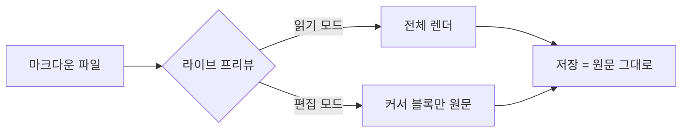
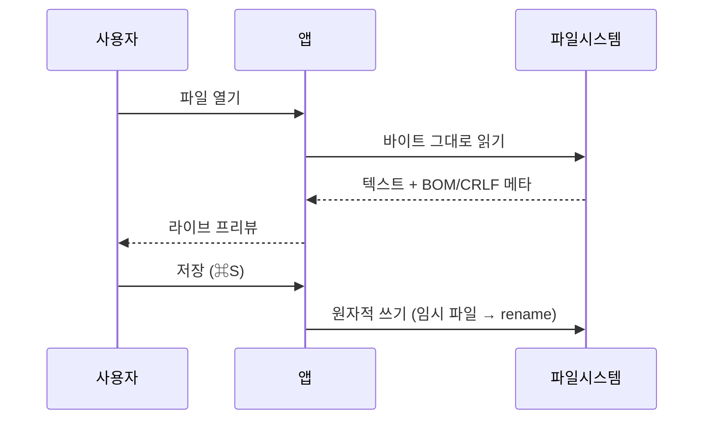

# IYAGI Markdown — 기능 둘러보기

이 문서는 앱의 모든 렌더링 기능을 한 번에 보여 주는 샘플이다. **굵게**, *기울임*, ~~취소선~~, `인라인 코드`를 포함하고 [외부 링크](https://example.com)와 [내부 문서 링크](sample-kr.md)도 있다.

## 기본 블록

> 인용문은 왼쪽 막대로 표시된다. 커서를 올리면 원문이 나타난다.

- 목록 항목 하나
- 목록 항목 둘
  - 중첩 항목
- [ ] 작업: 할 일
- [x] 작업: 끝낸 일

1. 순서 목록
2. 두 번째 항목

---

## 표 (GFM)

| 기능 | 상태 | 비고 |
|:-----|:----:|----:|
| 라이브 프리뷰 | ✅ | 커서 줄만 원문 |
| 표 위젯 | ✅ | 정렬 유지 |
| 수식 | ✅ | KaTeX |
| 다이어그램 | ✅ | mermaid |

## 코드 블록

```rust
fn main() {
    // 구문 강조는 중첩 파서가 담당한다.
    let greeting = "안녕, 마크다운";
    println!("{greeting}");
}
```

```python
def fib(n: int) -> int:
    return n if n < 2 else fib(n - 1) + fib(n - 2)
```

## 수식 (KaTeX)

인라인 수식 $E = mc^2$와 디스플레이 수식:

$$
\int_{-\infty}^{\infty} e^{-x^2}\,dx = \sqrt{\pi}
$$

$$
\sum_{n=1}^{\infty} \frac{1}{n^2} = \frac{\pi^2}{6}
$$

## 다이어그램 (mermaid)





## 이미지


## 줄 바꿈과 원문 보존

마지막 줄에 개행이 없는 문서도 그대로 보존된다. 저장은 언제나 버퍼 텍스트 그대로다.
